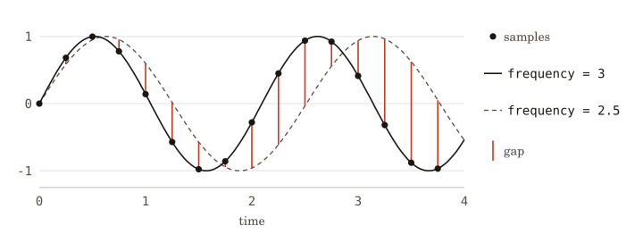
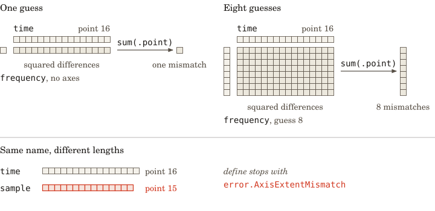
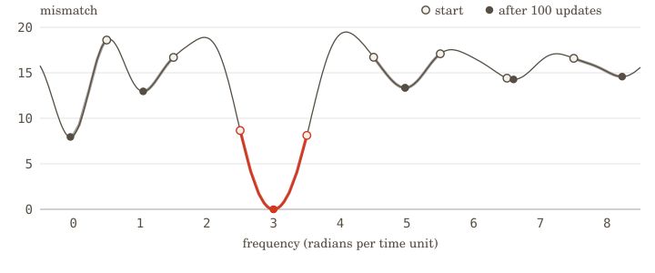

<p align="center">
  
</p>

- **Purpose:** Compiles array programs written in Zig for CPUs and GPUs.

Array programs (simulations, learned models, inference algorithms) should be
written once and run on whatever hardware is at hand: an NVIDIA GPU, the Metal
GPU in a laptop, a web browser, or a plain CPU. That portability usually comes
from a Python framework, such as JAX or PyTorch, built over each vendor's
runtime. Accy compiles array programs written in ordinary Zig for each of these
devices, through one interface.

Accy runs a Zig function on placeholder inputs, whose dimensions have names, to
record the array operations it performs. The recording can then be transformed
and compiled for a device.

## Install

The source archive is attached to the GitHub release, and `gh` downloads it:

```sh
gh release download v26.10.2 --repo a-tiny-project/accy --pattern 'accy-v26.10.2.tar.gz'
tar -xzf accy-v26.10.2.tar.gz
```

Accy builds with the official Zig 0.17.0 release. The extracted directory is a
Nix flake, and its default development shell supplies that compiler on x86_64
Linux and Apple silicon macOS. A project that depends on Accy builds with any
Zig 0.17.0, such as the one in that shell, and fetches the archive:

```sh
nix develop /path/to/accy-v26.10.2
zig fetch --save=accy /path/to/accy-v26.10.2.tar.gz
```

The project's `build.zig` then imports the `accy` module:

```zig
const accy = b.dependency("accy", .{ .target = target, .optimize = optimize });
const root = b.createModule(.{
    .root_source_file = b.path("src/main.zig"),
    .target = target,
    .optimize = optimize,
    .imports = &.{.{ .name = "accy", .module = accy.module("accy") }},
});
```

The archive holds the sources the `accy` module compiles, without their tests,
and a consumer program in `examples/consumer` that imports the module this way.
Before each release, that program builds and runs against the archive on x86_64
Linux and Apple silicon macOS.

## Use

Consider recovering the frequency of a sampled periodic signal. For a signal of
the form `sin(frequency * time)`, a candidate frequency predicts a value at each
sample time. Squaring the difference from each observation and adding the
squares gives one measure of mismatch: smaller values indicate a better fit.
Choosing the frequency that minimizes this sum gives a _least squares_ fit. Here
`frequency` is an angular frequency, in radians per unit of time.

The shared module below defines the mismatch calculation and constructs sixteen
samples of `sin(3 * time)`, taken a quarter time unit apart:

```zig
// tone.zig
const accy = @import("accy");
const tensor = accy.tensor;

pub const points = 16;

pub fn mismatch(_: *tensor.Builder, args: []const tensor.Value) !tensor.Value {
    const frequency = args[0];
    const time = args[1];
    const sample = args[2];
    const predicted = try (try frequency.mul(time)).sin();
    const difference = try predicted.sub(sample);
    return (try difference.mul(difference)).sum(.point);
}

pub fn samples() struct { time: [points]f32, sample: [points]f32 } {
    var time: [points]f32 = undefined;
    var sample: [points]f32 = undefined;
    for (0..points) |i| {
        time[i] = 0.25 * @as(f32, @floatFromInt(i));
        sample[i] = @sin(3 * time[i]);
    }
    return .{ .time = time, .sample = sample };
}
```

Save this module as `examples/consumer/src/tone.zig` in the release archive.
Each of the three tests below is a complete `main.zig` that imports it. To run a
test, save its listing as `examples/consumer/src/main.zig`, then run the
following command from the archive root on an x86-64 host:

```sh
zig build --build-file examples/consumer/build.zig test
```

The first test records and runs the calculation for one guess. Its inputs use
32-bit floats (`f32`). The time and sample arrays each have a dimension (an
_axis_) named `point`, while the frequency is a scalar with no axes:

```zig
// main.zig
const std = @import("std");
const accy = @import("accy");
const tensor = accy.tensor;
const tone = @import("tone.zig");

test "measure one frequency guess" {
    if (!accy.target.native_cpu_artifacts_supported) return error.SkipZigTest;
    const allocator = std.testing.allocator;
    const one_guess = [_]tensor.Spec{
        tensor.spec(.f32, .{}),
        tensor.spec(.f32, .{ .point = tone.points }),
        tensor.spec(.f32, .{ .point = tone.points }),
    };
    var program = try tensor.define(
        allocator,
        "mismatch",
        &one_guess,
        tone.mismatch,
    );
    defer program.deinit();

    const data = tone.samples();
    const frequency = [1]f32{2.5};
    var value: [1]f32 = undefined;
    try tensor.runCpu(allocator, &program, &.{
        std.mem.sliceAsBytes(&frequency),
        std.mem.sliceAsBytes(&data.time),
        std.mem.sliceAsBytes(&data.sample),
    }, &.{std.mem.sliceAsBytes(&value)});
    var expected: f64 = 0;
    for (data.time, data.sample) |time, sample| {
        const gap = @sin(2.5 * @as(f64, time)) - sample;
        expected += gap * gap;
    }
    try std.testing.expectApproxEqAbs(expected, @as(f64, value[0]), 0.0001);
}
```

`define` creates placeholders with the specified types and axes, calls
`mismatch`, and records its operations. `runCpu` compiles the recording for the
host CPU and runs it on arrays passed as byte slices. The test checks the result
against the sum of squared differences.

For sixteen samples at times `0, 0.25, ..., 3.75`, generated from
`sin(3 * time)`, a frequency guess of `2.5` gives a mismatch of about `8.656`. A
guess of `3` gives zero. The samples and the two predictions are shown below.

<p align="center"></p>

_Sixteen samples of `sin(3 * time)` (dots), taken at `0, 0.25, ..., 3.75`. The
prediction for frequency `3` (solid) passes through every sample. The prediction
for `2.5` (dashed) misses them, and red marks each gap. The mismatch adds the
squares of these gaps: about `8.656` for `2.5` and zero for `3`._

## Comparing guesses with named axes

Multiplying the scalar frequency by `time` repeats it across `point`, so the
prediction has one value per sample. This repetition across a missing axis is
called _broadcasting_. Subtracting `sample` matches elements along `point`, and
`sum(.point)` reduces those squared differences to one number.

To compare eight guesses at once, the frequency input gains an axis named
`guess`. The calculation in `mismatch` stays the same:

```zig
// main.zig
const std = @import("std");
const accy = @import("accy");
const tensor = accy.tensor;
const tone = @import("tone.zig");

test "compare eight frequency guesses" {
    if (!accy.target.native_cpu_artifacts_supported) return error.SkipZigTest;
    const allocator = std.testing.allocator;
    const guesses = 8;
    const eight_guesses = [_]tensor.Spec{
        tensor.spec(.f32, .{ .guess = guesses }),
        tensor.spec(.f32, .{ .point = tone.points }),
        tensor.spec(.f32, .{ .point = tone.points }),
    };
    var program = try tensor.define(
        allocator,
        "mismatch",
        &eight_guesses,
        tone.mismatch,
    );
    defer program.deinit();

    const data = tone.samples();
    const frequency = [guesses]f32{ 0.5, 1.5, 2.5, 3.5, 4.5, 5.5, 6.5, 7.5 };
    var value: [guesses]f32 = undefined;
    try tensor.runCpu(allocator, &program, &.{
        std.mem.sliceAsBytes(&frequency),
        std.mem.sliceAsBytes(&data.time),
        std.mem.sliceAsBytes(&data.sample),
    }, &.{std.mem.sliceAsBytes(&value)});
    for (frequency, value) |guess, actual| {
        var expected: f64 = 0;
        for (data.time, data.sample) |time, sample| {
            const gap = @sin(@as(f64, guess) * time) - sample;
            expected += gap * gap;
        }
        try std.testing.expectApproxEqAbs(expected, @as(f64, actual), 0.0001);
    }
}
```

Now `frequency * time` has two axes, `guess` and `point`: one predicted value
for every pair of a guess and a sample time. The body of `mismatch` still sums
along `point`, so the result contains one mismatch per guess. The names keep the
two dimensions separate even when the numbers of guesses and points happen to be
equal.

<p align="center"></p>

_Each small square is an array element. A scalar frequency repeats across
`point`. Frequencies along `guess` form a grid with `point`. The squared
differences keep those axes, and `sum(.point)` leaves one mismatch per guess.
Red marks a length that disagrees with another axis of the same name._

Axes with the same name must have the same length. Giving `sample` fifteen
points while `time` has sixteen makes recording return
`error.AxisExtentMismatch`.

## Improving each guess

A fixed set of guesses gives only a coarse search. To refine a guess, the
program needs the mismatch's slope with respect to frequency: how the mismatch
changes when frequency changes slightly. This derivative tells an update which
direction decreases the mismatch. `valueAndGrad` constructs a program that
returns both the mismatch and its derivative, selecting the frequency input by
its index, `0`.

Accy's gradient transformation expects one scalar output, so it applies to the
one-guess program. A `Function` keeps that recording and its derived programs
together, freeing them through one `deinit`. To obtain a mismatch and derivative
for each guess, `vmap` transforms the derivative program to run over an added
axis. The following test compiles that program once and uses it for 100 updates:

```zig
// main.zig
const std = @import("std");
const accy = @import("accy");
const tensor = accy.tensor;
const tone = @import("tone.zig");

test "refine eight frequency guesses" {
    if (!accy.target.native_cpu_artifacts_supported) return error.SkipZigTest;
    const allocator = std.testing.allocator;
    const guesses = 8;
    const one_guess = [_]tensor.Spec{
        tensor.spec(.f32, .{}),
        tensor.spec(.f32, .{ .point = tone.points }),
        tensor.spec(.f32, .{ .point = tone.points }),
    };
    var f = try tensor.Function.define(
        allocator,
        "mismatch",
        &one_guess,
        tone.mismatch,
    );
    defer f.deinit();
    const each = try (try f.valueAndGrad(.{ .wrt = &.{0} })).vmap(.{
        .axis_size = guesses,
        .in_axes = &.{ tensor.mappedAxis(0), .none, .none },
        .axis_name = "guess",
    });
    var cpu = try each.compileCpu();
    defer cpu.deinit();

    const data = tone.samples();
    var frequency = [guesses]f32{ 0.5, 1.5, 2.5, 3.5, 4.5, 5.5, 6.5, 7.5 };
    var value: [guesses]f32 = undefined;
    var slope: [guesses]f32 = undefined;
    for (0..100) |_| {
        try cpu.launch(allocator, &.{
            std.mem.sliceAsBytes(&frequency),
            std.mem.sliceAsBytes(&data.time),
            std.mem.sliceAsBytes(&data.sample),
        }, &.{ std.mem.sliceAsBytes(&value), std.mem.sliceAsBytes(&slope) });
        for (&frequency, slope) |*guess, derivative| guess.* -= 0.005 * derivative;
    }
    try std.testing.expectApproxEqAbs(@as(f32, 3), frequency[2], 0.000001);
    try std.testing.expectApproxEqAbs(@as(f32, 3), frequency[3], 0.000001);
}
```

`mappedAxis(0)` gives the frequency input a new leading axis, named `guess`. The
two `.none` entries keep the times and samples shared by every guess. The
original function and its derivative still describe one guess.

After each call, the example subtracts `0.005 * slope` from each frequency, a
_gradient descent_ step. At `2.5`, the slope is about `-31.29`, so subtracting
`0.005 * slope` raises the frequency toward `3`. Starting at
`0.5, 1.5, ..., 7.5` and taking 100 steps brings the guesses that began at `2.5`
and `3.5` to approximately `3`, with mismatch near zero. The other six end in
other valleys, with mismatches between `7.9` and `14.6`, as the mismatch curve
below shows.

<p align="center"></p>

_Mismatch for the sampled signal over frequencies from `-0.5` to `8.5` (thin
curve). Each guess starts at an open circle and follows its own slope for 100
updates to a filled circle. The two that start at `2.5` and `3.5`, in red, reach
approximately `3`, with mismatch near zero. The others end in other valleys._

A derivative gives a local direction of improvement. The multiple valleys
explain why one starting guess can give a poor fit, and why comparing the final
mismatches from different starts helps find the frequency that generated these
samples. Because `valueAndGrad` and `vmap` both return recorded programs, Accy
can compose them before compiling the result.

## Compiling for a device

Accy translates the recorded array operations into loops using
[Choir](deps/lib/compiler/choir/), the compiler library included with Accy. The compiler can
then choose loop order and how to divide arrays into tiles for a device's
memory. Each device provides an interface (a _backend_) for allocating buffers,
loading compiled functions (_kernels_), and running them. The example uses
`compileCpu` to build an executor for the host CPU and `launch` to call it with
input and output arrays passed as byte slices.

Accy generates x86-64 machine code for CPUs, PTX for NVIDIA GPUs, SPIR-V for
Vulkan, MSL for Metal, WGSL for WebGPU, and WebAssembly.

## Limits

- `compileCpu` and `runCpu` require an x86-64 host because the generated machine
  code runs in the calling process.
- The default arithmetic mode is `exact`. TF32 (reduced-precision floats on
  NVIDIA tensor cores) requires CUDA. Compilation fails if a kernel cannot use
  the requested TF32 mode.
- Saving compiled programs for reuse requires a record of how the compiler
  itself was built. A project's own build lacks this record, so saving or
  restoring compiled programs returns `error.UnrecordedCompilerBuild`. The
  executor above keeps its compiled program in memory and supports repeated
  calls.

## Code

- [Public namespace and design notes](src/root.zig)
- [Recording and transforming array programs](src/tensor/root.zig)
- [Recorded functions, gradients, and batching](src/tensor/function.zig)
- [Compilation stages](src/preparation/)
- [Compiled functions and the kernel library](src/kernel/root.zig)

- [Build](build.zig)

## References

- [XLA](https://openxla.org/xla): typed graphs of array operations.
- [StableHLO](https://openxla.org/stablehlo): the model for array operation
  definitions. Accy uses its own representation of these operations.
- [PJRT](https://github.com/openxla/xla/tree/main/xla/pjrt): the model for a
  common interface to device runtimes. Accy implements its own backends.
- [MLIR](https://mlir.llvm.org/): the model for Choir.

## License

AGPL-3.0-or-later. See [LICENSE](LICENSE).
